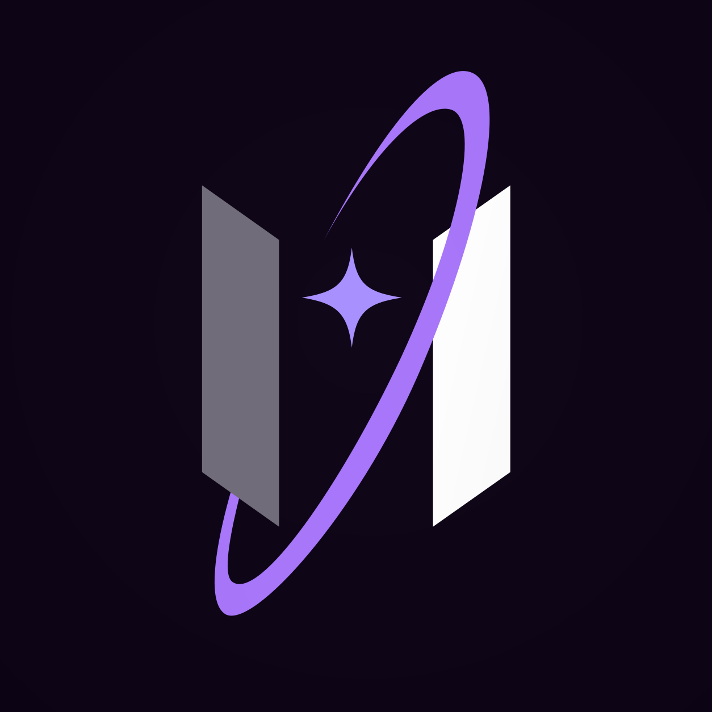
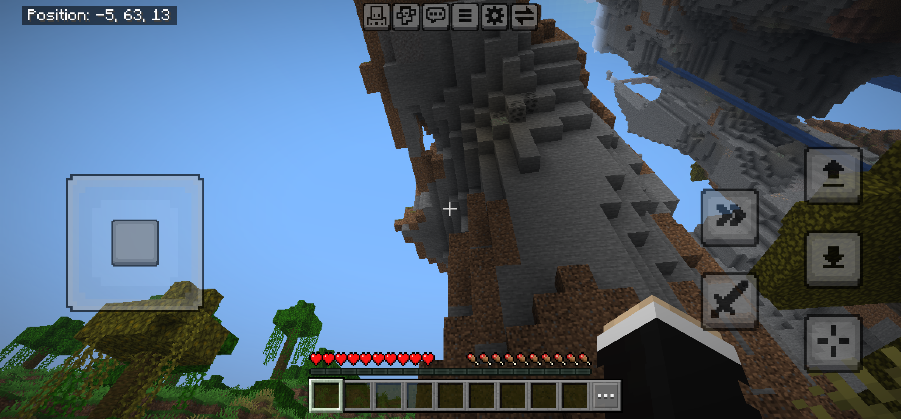
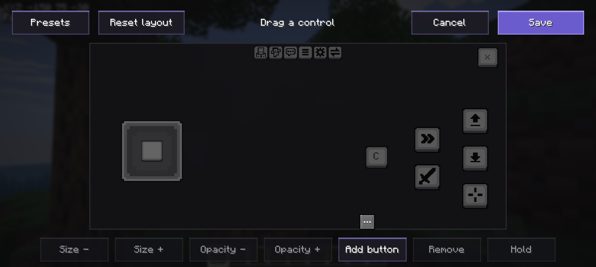

  

<h1 align="center">Meridian</h1>

  <strong>Minecraft: Java Edition 26.3 on Android, powered by Horizon.</strong> 
  An unofficial mobile port with native Vulkan rendering, a touch-first launcher, and customizable on-screen controls.

  <a href="#what-you-can-do"><strong>Features</strong></a> ·
  <a href="packaging/android/README.md"><strong>Build guide</strong></a> ·
  <a href="CONTRIBUTING.md"><strong>Contributing</strong></a> ·
  <a href="https://github.com/10yukine/Meridian/issues"><strong>Report an issue</strong></a>

> [!NOTE]
> **In development.** Meridian is available to build from source. There is no public APK release yet. Android is the current focus.

   
  Survival gameplay on a Galaxy A32, captured from an Android development build.

## What you can do

- **Play on your phone.** Start a singleplayer world or play over LAN with another device on the same Wi-Fi.
- **Make the controls your own.** Choose a joystick or classic D-pad, move and resize buttons, add custom keys, and save separate layouts. You can import Amethyst and Pojav control layouts.
- **Set up on-device.** Download and prepare the required game files on the phone, manage separate profiles, preview skins in 3D, and install compatible Horizon WebAssembly mods.
- **Bring your worlds with you.** Import Java Edition worlds, resource packs, and shader packs through Android's file picker. Export saves as ZIP files to back them up or move them to another device.

See the touch layout editor

 

## Build and play

You'll need an **ARM64 phone running Android 8.0 or later** with Vulkan support, plus your own copy of **Minecraft: Java Edition**. Development builds have been tested on the Galaxy A14 5G and Galaxy A32.

Follow the [Android build guide](packaging/android/README.md) to install the toolchain, build an APK, and prepare the game files. The game files come from Mojang and are downloaded or prepared separately from the APK.

**Microsoft sign-in** has been tested with Meridian's app registration, which Mojang has allowlisted for Minecraft API access. Sign-in requires a build configured with that registration.

## Credits and license

Meridian is maintained by [Yukine](https://github.com/10yukine) and built on [Horizon](https://playhorizon.dev/), created by Ludovic Marie and the Horizon team. See the [contribution guide](CONTRIBUTING.md) for where to send changes.

The project's original work is licensed under [LGPL-3.0-or-later](LICENSE). Code retained under the [MIT license](LICENSES/MIT.txt) and other third-party terms is documented in the [third-party notices](THIRD_PARTY_NOTICES.md).

NOT AN OFFICIAL MINECRAFT PRODUCT. NOT APPROVED BY OR ASSOCIATED WITH MOJANG OR MICROSOFT. Minecraft is a trademark of Mojang Synergies AB. See the <a href="https://www.minecraft.net/en-us/eula">Minecraft EULA</a>.
